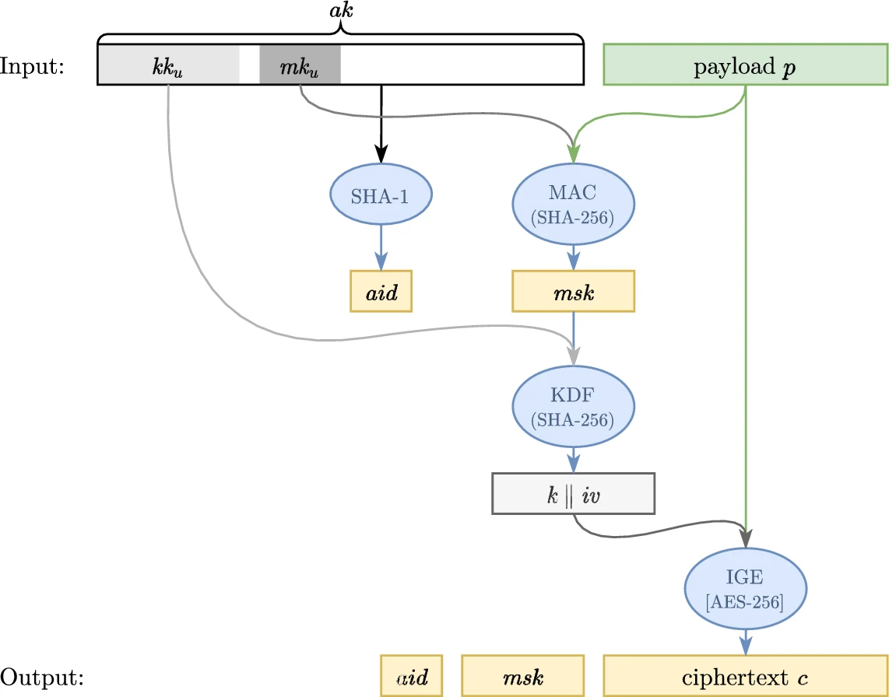

# 0.5 <span style="color:rgb(250, 250, 250)">Используемые библиотеки</span>

**1\.** Для обработки gpg ключей используется библиотека GPGME

**2\.** Для шифрования и дешифрования сообщений в режиме защищённого соединения используется алгоритм AES IGE, реализованный в библиотеке OpenSSL.

**3\.** Для выработки общего секрета в процессе установления защищённого соединения используется алгоритм Диффи-Хеллмана, реализованный в библиотеке OpenSSL.

**4\.** В качестве БД используется SQLite.

# 1. <span style="color:rgb(250, 250, 250)">Установление защищённого соединения (точка-точка)</span>

**1\.** Боб и Алиса работают независимо с обычным телеграмом

**2\.** Боб и Алиса договорились, что хотят установить защищенное соединение и дальше общаться по нему.

**3\.** они выбирают, кто из них будет инициатором защищенного соединение (пусть это будет алиса).

**4\.** Алиса в пользовательском интерфейсе (пусть, это будет кастомная кнопка в интерфейсе чата, при нажатии на которую выходит меню-список с кнопками, одна из которых используется для установления зщ) выбирает опцию инициировать защищенное соединение с использованием публичного gpg ключа k_a Алисы, подходящего для подписи (если таких ключей зарегистрировано несколько, то она выбирает один желаемый из списка).

**4.1** Далее автоматически собирается и отправляется Бобу посылка следующего формата, полностью закодированная в base64 за исключением заголовка:

```
{
[заголовок, обозначающий запрос установления зщ]
[параметры инициатора DH Алисы]
[expiration date]
[timestamp]
[user_id Алисы]
[user_id Боба]
[публичный ключ алисы k_a]
[salt]
}
[подпись части в фигурных скобках ключом, парным к k_a]
```

**4.1.1** Заголовок -- некоторая фиксированная последовательность байт.

**4.1.2** Возможно, вместо timestamp стоит взять uuid или что-то подобное другое.

**4.1.3** salt -- случайные байт, возможно, вообще не нужны, учитывая, что есть timestamp или uuid.

**4.1.4** Параметры DH, скорее всего будут не сильно больше 512 символов, если учитывать, что публичный ключ размером 4096 бит и что base64 увеличивает размер текста в средне в 4/3 раз, то в сумме параметры и ключ они займут ~768 байт, чего с большим хватает, чтобы не превысить ограничение в 4096 символов (байт) от телеграма. Поэтому проблем не должно быть даже с ключами в несколько раз больше.

**5\.** Боб получает запрос Алисы и с помощью GUI (пусть это будет кнопка в контекстном меню, всплывающем, при нажатии на сообщение) подтверждает установку защищенного соединения (например, вызывает контекстное меню на сообщение алисы и выбирает опцию установить зщ), Боб увидит всплывающее окно с информацией про ключ Алисы k_a с автоматической проверкой через gpg (в окне должно быть видно соответствующая надпись про безопасность ключа, выбор, установить ли соединение в любом случае остается за Бобом), доверенный ли ключ, и уточнение, точно ли Боб хочет установить соединение и использовать свой gpg публичный ключ k_b, пригодный для подписи (если таких ключей зарегистрировано несколько, то он выбирает один желаемый из списка). Допустим, Боб отвечает да.

**6\.** Далее автоматически собирается и отправляется Алисе посылка следующего формата, полностью закодированная в base64 за исключением заголовка:

```
{
[заголовок, обозначающий согласие установления зщ]
[параметры DH Боба]
[expiration date]
[timestamp]
[user_id Алисы]
[user_id Боба]
[публичный ключ Боба k_b]
[salt]
}
[подпись части в фигурных скобках ключом, парным к k_b]
```

**7\.** Алиса получает согласие Боба, далее она увидит всплывающее окно с информацией про ключ Боба k_b с автоматической проверкой через gpg, доверенный ли ключ, и уточнение, хочет ли Алиса отменить защищенное соединение.

**8\.a** При подтверждении защищённого соединения Алисой/Бобом, У Алисы/Боба из собранных параметров DH собирается общий секрет S_j и в БД Алисы/Боба создаётся пометка, что сообщения в этом чате сообщения с номером i и выше расшифровываются с помощью секрета S_j.

**8\.b** Если какое-либо сообщение (запрос Алисы или ответ Боба) имеет неверный формат, подпись, любое другое нарушение структуры, то оно игнорируется клиентом (либо пользователю приходит оповещение, о том, что ему отправили некорректный запрос, и предупреждение быть осторожным) и в контекстном меню сообщения отсутствует/запрещена опция установления зщ.

**8\.c** Если же на одной из стадии Алиса/Боб отменил установление зщ, либо уже после установления соединения, а так же при смене ключа Алиса/Боб отправляет (с помощью GUI) отзывное сообщение. При отправке/получении отзывного сообщения (и ОБЯЗАТЕЛЬНО только после подтверждения пользователя, если оно требуется, например, в случае, если отзывное сообщение приходит уже после успешного установления зщ, а не в процессе его установления) в БД делается закрывающая пометка, что сообщение t (id последнего сообщения в этой сессии зщ) последнее, что шифруется секретом S_j, если t=i, то нужно удалить пометку вообще.

**8\.d** Если же Боб проигнорирует запрос Алисы на установление зщ, Алисин запрос просрочится через заданный небольшой промежуток времени, после чего установить зщ по этому запросу будет невозможно, а информация о нём удалится (возможно, лениво).

# 2. <span style="color:rgb(250, 250, 250)">Установление защищённого соединения (точка)</span>

**1\.** Алиса захотела включить шифрование сообщений в saved messages, для этого она в пользовательском интерфейсе (пусть, это будет кастомная кнопка в интерфейсе чата, при нажатии на которую выходит меню-список с кнопками, одна из которых используется для установления зщ) выбирает опцию инициировать шифрование, выбирает expiration date ключа.

**2\.** Генерируется ключ шифрования, в БД делается такая же как в случае защищенного соединения точка-точка пометка начала интервала шифрования для чата save messages.

**3\.** При отмене шифрования или регенерации ключа, в БД делается такая же как в случае защищенного соединения точка-точка пометка конца интервала шифрования для чата save messages.


# 3. <span style="color:rgb(250, 250, 250)">Установление защищённого соединения (многоточка)</span>

**1\.** Алиса и ещё N юзеров являются участниками группового чата, они договорились установить защищенное соединение

**2\.** Один из участников должен быть инициатором (пусть это будет Алиса).

**3\.** Алиса в пользовательском интерфейсе (пусть, это будет кастомная кнопка в интерфейсе чата, при нажатии на которую выходит меню-список с кнопками, одна из которых используется для установления зщ) выбирает опцию инициировать защищенное соединение с использованием публичного gpg ключа k_a Алисы, подходящего для подписи (если таких ключей зарегистрировано несколько, то она выбирает один желаемый из списка).

**3.1** Далее автоматически собирается и отправляется в чат посылка следующего формата, полностью закодированная в base64 за исключением заголовка:

```
{
[заголовок, обозначающий запрос установления зщ]
[параметры инициатора DH Алисы (модуль и основа DH, без публичного ключа Алисы)]
[expiration date]
[timestamp]
[user_id Алисы]
[used_id всех участников чата]
[публичный ключ алисы k_a]
[salt]
}
[подпись части в фигурных скобках ключом, парным к k_a]
```

**4\.** Каждый другой участник чата получает запрос Алисы и с помощью GUI (пусть это будет кнопка в контекстном меню, всплывающем, при нажатии на сообщение) подтверждает установку защищенного соединения (например, вызывает контекстное меню на сообщение алисы и выбирает опцию установить зщ), участник увидит всплывающее окно с уточнением, хочет ли участник установить соединение и использовать свой gpg публичный ключ k_i, пригодный для подписи (если таких ключей зарегистрировано несколько, то он выбирает один желаемый из списка). Допустим, участник проделывает это и отвечает подтверждает установление зщ.

**5\.1** При этом для установления зщ в беседе необходимо, чтобы каждый её участник (очевидно, кроме инициатора) подтвердил это, проделав описанные действия.

**5\.2** Далее пользователь видит окно с просьбой подождать и кнопкой отменить установку зщ, пока его клиент автоматически вырабатывает общий секрет с участниками чата.

**5\.3** Выработка общего секрета происходит по фиксированной схеме со строгим порядком отсылки очередной части общего секрета пользователями, который определяется порядком id пользователей в отсортированном массиве.В установленном порядке пользователи собирают и отправляется в чат посылку следующего формата, полностью закодированную в base64 за исключением заголовка:

```
{
[заголовок, обозначающий согласие установления зщ]
[параметры DH участника (следующий общий секрет)]
[номер посылки в схеме]
[expiration date]
[timestamp]
[user_id Алисы]
[user_id участника]
[массив used_id всех остальных участников чата]
[публичный ключ участника k_i]
[salt]
}
[подпись части в фигурных скобках ключом, парным к k_i]
```

**5\.4** Схема обмена состоит из (N + 2)(N + 1)/2 - 1 посылок (N+1 -- кол-во участников беседы). Есть и более простой в реализации вариант схемы из N(N+1), стоит выбрать какой использовать в итоге.

**6\.** Когда будут сделаны все (N + 2)(N + 1)/2 - 1 посылок, из которых состоит фиксированная схема, общий секрет сможет быть выработан каждым участником. Каждый участник выработает общий секрет, у каждого участника закроется окно с просьбой подождать и всплывёт окно (видимо, scrollable элемент) с информаций про gpg ключи остальных участников с автоматической проверкой через gpg (в окне должно быть видна соответствующая надпись про безопасность каждого ключа, выбор, установить ли соединение в любом случае остается за участником), доверенные ли ключи, и уточнение, точно ли он хочет установить соединение.

**7\.a** При подтверждении защищённого соединения участником, его БД создаётся пометка, что сообщения в этом чате сообщения с номером i и выше расшифровываются с помощью выработанного секрета S_j.

**7\.b** Если сообщение какого-либо из участников имеет неверный формат, подпись, любое другое нарушение структуры, то оно игнорируется клиентом остальных участников (либо каждый видит оповещение, о том, что ему отправили некорректный запрос, и предупреждение быть осторожным) и в контекстном меню сообщения отсутствует/запрещена опция установления зщ.

**7\.c** Если же на одной из стадий какой-то из участников отменил установление зщ, либо уже после установления соединения, а так же при смене ключа он отправляет (пусть, это будет кастомная кнопка в интерфейсе чата, при нажатии на которую выходит меню-список с кнопками, одна из которых используется для отмены зщ) отзывное сообщение. При отправке/получении отзывного сообщения (и ОБЯЗАТЕЛЬНО только после подтверждения пользователя, если оно требуется, например, в случае, если отзывное сообщение приходит уже после успешного установления зщ, а не в процессе его установления) в БД делается закрывающая пометка, что сообщение t (id последнего сообщения в этой сессии зщ) последнее, что шифруется секретом S_j, если t=i, то нужно удалить пометку вообще.

**7\.d** Если же кто-то из участников проигнорирует запрос Алисы на установление зщ, Алисин запрос просрочится через заданный небольшой промежуток времени, после чего установить зщ по этому запросу будет невозможно, а информация о нём удалится (возможно, лениво) у всех.

# 4. <span style="color:rgb(250, 250, 250)">Отправка сообщений, шифрование</span>

**1\.** Алиса отправляет сообщение (пусть M -- текст сообщения виде последовательности байт) в чат (будь то saved messages, переписка с одним человеком или групповой чат).

**2\.a** Если в чате не активна сессия защищённого соединения (определяется клиентом локально, это должно быть отражено в GUI, например, пометка замочка на чате), то сообщение не проходит никакой обработки и отправляется в чат так, как бы отправилось с обычного телеграм клиента.

**2\.b** Если же в чате действует сессия защищённого соединения, происходит следующее: из БД клиента берётся нужный секрет S, из фиксированной части S и M целиком с помощью KDF (SHA256, например) ключ K_m, далее из S и K_m генерируется с помощью KDF и не которого перемешивания ключ K для шифрования по алгоритму AES и набор из двух начальных векторов IV (initial vectors) для шифрования по алгоритму AES IGE (AES IGE использует AES как один из шагов, поэтому для AES IGE необходим ключ K).

Стоит заметить, что закрытие зщ при нормальной работе клиента всегда происходит только после подтверждения пользователя, чтобы исключить ситуацию отправки сообщения, которое предполагается тайным, сразу после закрытия зщ (например, собеседник решил его закрыть). Даже если собеседник отозвал зщ, до тех пор, пока другой пользователь не подтвердит это локально через GUI, его сообщения будут отправлять зашифрованными (либо не будут отправляться, будет уточнено далее). 

**3\.** Далее строится итоговая зашифрованная посылка: 

Cypher = Base64(S_{id} + K_m + AES_IGE(Size(M) + M + R, K, IV)), где S_{id} -- часть sha-1 хеша от всего значения S, R -- последовательность случайных байт, длина последовательности тоже генерируется случайно, но так, чтобы общая длина всего Cypher была не меньше некоторой фиксированной величины min_cypher_size, Size(M) -- размер M в байт, AES_IGE(Size(M) + M + R, K, IV) -- результат шифрования Size(M) + M + R  по алгоритму AES IGE с начальными векторами IV и ключом K, "+" обозначает операцию конкатенации.

**3\.1** Вот неплохая диаграмма, описывающая процесс (не я её нарисовал, поэтому обозначения тут другие):

_Illustration of the symmetric cryptography used in MTProto 2.0. The input ak 
denotes the shared secret key resulting from the key exchange, while the input p
represents the (encoded) plaintext payload._

**4\.** Cypher становится текстом посылаемого сообщения, из сообщения удаляется вся потенциально небезопасная (может дать дополнительную информацию о том, что содержит исходный текст, пригодиться в его криптоанализе и т.д.) метаинформация, например, entities в тексте, которые кодируют информацию о форматировании в сообщении (например, интервалы выделения жирным шрифтом, ссылки). Сообщение помечается в GUI как зашифрованное (например, на нем отображается символ замочка).

**5\.** Сообщение отправляется в чат.

**6\.** При получении этого сообщения обратно от сервера, либо сразу после отправки его в чат (в зависимости от чата сообщение получает своё id по-разному, либо от сервера, либо оно известно при отправке) значение t этого чата (id последнего зарегистрированного сообщения в текущей сессии зщ) изменяется на max(t, id) (разумно будет сразу сделать эту запись в БД, чтобы уменьшить шанс десинхронизации интервала зщ в случае краша приложения), где id -- выданный сервером порядковый идентификатор этого сообщения. (вообще этот пункт наполовину относится к дешифрованию сообщений, но я оставлю его и тут)


# 5. <span style="color:rgb(250, 250, 250)">Получение сообщений, дешифрование</span>

**1\.** Телеграм-клиент Алисы получает от сервера некоторые обновления.

**2\.** Допустим, обновления содержат сообщения в чатах, в таком случае каждое сообщение проходит следующую обработку.

**3\.** Сначала определяется по данным в БД, попадает ли пришедшее сообщение в какой-либо интервал зашифрованных сообщений, если нет, то сообщение проходит без изменений. Далее описывается, что происходит с каждым зашифрованным сообщением.

**4\.** Пусть зашифрованное сообщение попало в интервал шифрования j (это может быть какой-то закрытый сеанс зщ в истории чата, либо текущий сеанс зщ), из бд достаётся соответствующий секрет S_j. Сообщение декодируется обратно из Base64, из него достаются параметры S_{id}, K_m и зашифрованный текст сообщения E, проверяется, что S_{id} действительно соответствует S_j, выполняются и всё остальные проверки на целостность и корректность полученных данных. Из S_j и K_m аналогично пункту 2 в разделе 4 выводятся K и IV. С помощью K и IV происходит расшифрование E, достаётся набор исходных параметров Size(M), M, R, (в теории возможна статистическая проверка R на случайность на основе, например, L последних сообщений в чате).

**5\.a** Если где-то в этом процессе произошло несоответствие, то текст сообщения инвалидируется, а в GUI пользователю даётся понять, что ему пришло некорректное сообщение (м.б. пометка на самом сообщении или его текст заменяется на текст ошибки/предупреждения). Под этот сценарий попадает случай, когда в чат с активным зщ приходит незашифрованное сообщение (если, конечно же, незашифрованное сообщение каким-то чудом не обладает корректной с точки зрения алгоритма расшифрования структурой, шанс чего астрономически мал).

**5\.b** Если же никаких ошибок и несоответствий не произошло и не было  обнаружено, то текст обрабатываемого сообщения подменяется на исходный тайный текст M, а само сообщение помечается в GUI как зашифрованное (например, символом замочка на сообщении).

**6\.** Значение t этого чата (id последнего зарегистрированного сообщения в текущей сессии зщ) изменяется на max(t, id) (разумно будет сразу сделать эту запись в БД, чтобы уменьшить шанс десинхронизации интервала зщ в случае краша приложения), где id -- выданный сервером порядковый идентификатор этого сообщения.


# 6. <span style="color:rgb(250, 250, 250)">Замечания, элементы интерфейса и крайние случаи.</span>

**1\.1** У пользователя должна быть возможность скрыть все сообщения, что попадают в какой-либо интервал шифрования (и корректные и некорректные по своей структуре), а так же служебные сообщения для установки зщ (хотя можно реализовать их автоматическое удаление после установки или ошибки установления зщ) во всех чатах, либо в каждом чате по отдельности. Эта опция будет хорошо смотреться в кастомном меню, что открывается при нажатии на кастомную кнопку в чате, т.е. в том же меню, где находится опция установки/закрытия зщ.

**1\.2** У пользователя должна быть возможность одним действием полностью скрыть все кастомные элементы элементы GUI, зашифрованные и служебные сообщения (и корректные и некорректные по своей структуре) во всех чатах, т.е. замаскировать свой клиент под дефолтный телеграм. А так же возможность вернуть все скрытое обратно при (вариант 1) нажатии кастомной кнопки, глубоко зарытой в интерфейсе настроек телеграм, этот вариант всё-такие оставляет видимый кастомный элемент GUI; (вариант 2) выполнения некоторой, заданной пользователем при первом открытии модифицированного клинта или в кастомном меню, последовательности манипуляций с GUI (например, единицей такой последовательности может открытие saved messages, открытие списка архивированных чатов, открытие настроек и т.д.). Так же в этом режиме не будет применяться шифрование на исходящие сообщения, об этом пользователь будет предупрежден при включении этой опции. Сложнее решить, что делать с входящими сообщениями при активном зщ, скорее всего просто тоже их скрывать.

**1\.3** В дополнение к остальным параметрам конфиденциальности, можно добавить настройку, позволяющую скрыть все некорректные сообщения, что попадают в какой-либо сеанс зщ, а так же убрать пометки остальных зашифрованных сообщений (замочки). Кастомная кнопка в этом случае не скрывается, а если скрывать, то этот режим мало чем отличается от описанного в 1.2 этого раздела, в общем, вряд ли такая опция вообще нужна.

**1\.4** Пожалуй, стоит так же добавить опцию автоматического удаления (для всех пользователей) зашифрованных сообщений, а может и вообще всех сообщений, как только клиент о них узнает, либо просто через отправку запроса на удаление по всем чатам и выделенным id сообщений.

**1\.5** Служебные сообщения телеграм, уведомляющие, что пользователь печатает, клиент не должен отправлять в чатах с действующим зщ. Но при включённой опции маскировки всего клиента, сокрытия статуса печати быть не должно.

**2\.** Это уже было сказано выше, но при нормальной работе клиента закрытие окончательное зщ в чате происходит только после локального подтверждения пользователя через GUI, даже если его собеседник перестал расшифровывать сообщения новые сообщения последним общим секретом, в ином случае сообщения будут продолжать шифроваться последним общим секретом, либо не отвергаться клиентом и не отправляться вообще.

**3\.** После достижения expiration date некоторого действующего общего секрета в каком-либо чате, пользователь должен увидеть предупреждения о том, что ключ просрочился, и что крайне рекомендуется переустановить зщ как можно скорее (возможно, можно добавить опцию в кастомное меню, при включении которой, перед отправке сообщения зщ переустанавливается автоматически, если предыдущий секрет просрочился).

**3\.1** Можно, да и желательно, дополнить зщ двумя другими свойствами: [message limit] и [byte limit] -- ещё два порога, при пересечении которых, текущий секрет будет считаться просроченным. [message limit] -- максимальное количество сообщений за сеанс зщ, при пересечении которого секрет просрачивается, аналогично [byte limit] -- лимит на суммарный размер сообщений за сеанс зщ. Если имплементировать [byte limit], то обязательно нужно учитывать случайные байты R, добавляемые в конец текста при шифровании, иначе по количеству сообщений за сеанс можно будет строить предположения про истинный суммарный размер сообщений, хотя даже с учётом R можно пытаться строить какую-то статистику, т.к., как обсуждалось в разделе 4 пункт 3, есть фиксированный параметр min_cypher_size, из-за чего, разный размер набираемых пользователем сообщений будет менять распределение длин сообщений в сеансе зщ.

**3\.2** Как вариант, можно сделать min_cypher_size случайным на каждый сеанс зщ, либо, что ещё безопасней, форсировать итоговый размер сообщения в 4096 байт (лимит, заданный телеграмом, сообщения длиннее отвергаются сервером), это реализуемо даже с учётом того, что Base64 увеличивает размер посылки, хотя, возможно, создаст некоторые накладные расходы. Этот вариант делает ненужным параметр [byte limit], т.к. он будет эквивалентен [message limit].

**4\.** Это было сказано выше, но все сообщения, что попадают в какой-либо интервал шифрования, должны быть помечены в GUI либо как корректное зашифрованное сообщение (замочек), либо как некорректное (другой символ/подмена текста).

**5\.1** Отложенные сообщения плохо вписываются в описанный протокол взаимодействия, т.к. сервер выдаёт таким сообщениям id только перед непосредственной отправкой в чат, а значит возникнут проблемы с расшифровкой отложенных сообщений.

**5\.2** Есть несколько вариантов, что с ними делать: (вариант 1) ничего, пусть приходят, даже если не получится их эффективно расшифровать, но это будет противоречить идеей, что множество зашифрованных сообщений равно множеству сообщений, попадающих в какой-либо интервал зщ, из-за этого нельзя будет правильно скрыть все сообщения, что должны быть скрыты; (вариант 2) запретить отправку отложенных сообщений во время активного зщ, в таком случае не будет нарушено сокрытие сообщений, но во время активного зщ могут приходить отложенные сообщения из прошлых сеансов или незашифрованные отложенные сообщения, которые будут помечаться клиентом как некорректные, что уже гораздо более безобидно; (вариант 3) не полагаться на выданный сервером id, а поддерживать свой счётчик и вставлять в сообщения свои id, тогда отложенные сообщения смогут быть обработаны так же, как и обычные, без каких-либо проблем с корректностью расшифровки, но в таком случае может легко возникнуть рассинхронизация и битые сообщения из-за того, что у пользователей могут значительно различаться счётчики из-за неполадок сети, из-за чего возникнут сообщения с одинаковыми id и нарушится, например, подсчет количества сообщений, поэтому, в идеале, придётся создавать отдельный счётчик на каждого участника чата, а значит хранить какую-то информацию о чате в сообщениях или в БД, в том числе потому, что кто-то может покинуть беседу, в общем, это проблемный вариант. _Создавать ещё один слой, обеспечивающий надёжную рассылку, над аналогичным телеграмовским звучит как текст добровольного заявления о желании лечь в психиатрический стационар._ (вариант 4) класть в отложенные сообщения id первого сообщения в текущем сеансе зщ, это просто и вроде исключает все перечисленные проблемы.

**6\.** Черновики тоже не очень хорошо вписываются в картину, можно выделить для них как для отдельного чата свою строчку в БД для ключей, но у черновиков нет id, есть только date, с которым в целом тоже можно работать. Можно просто убрать отправку черновиков на сервер, когда отключена маскировка под обычный телеграм, в конце концов никто не мешает использовать saved messages в качестве безопасного хранилища для черновиков + может быть так, что при включении маскировки и выключении обратно клиент отправит запрос на удаление черновиков или подобный рассинхрон, из-за чего черновик потрётся. В общем, я считаю отключение черновиков вне маскировки разумный вариант.

**7\.** Любое изменение кастомных настроек, изменяющих внешний вид сообщений, скрывающих их и т.д., а по совместительству, видимо, и настроек, меняющих GUI (например, маскировка), будет требовать перезапуска клиента, т.к. убирать сообщения из живой истории ужасный и сложный вариант, требующий внедрения ещё больше кода в оригинальные файлы телеграм.