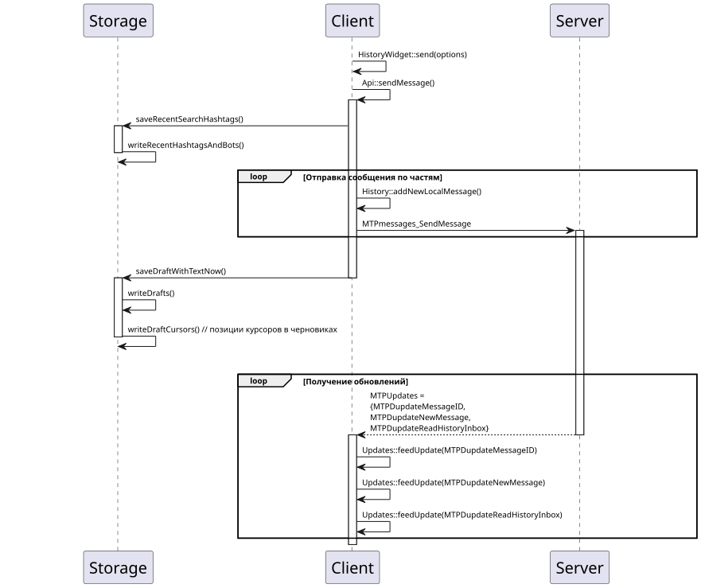
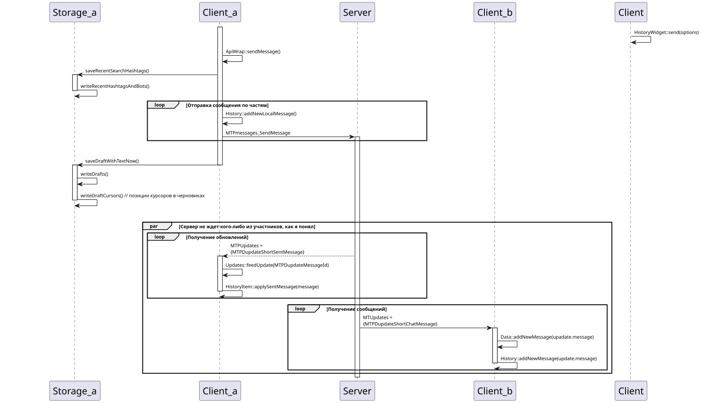
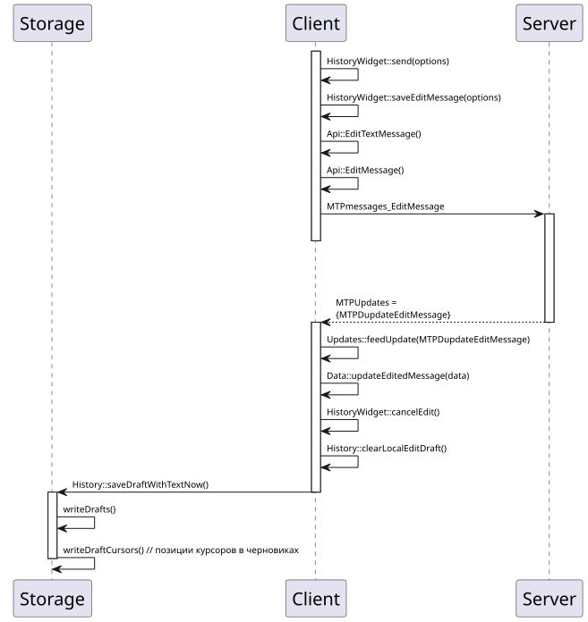
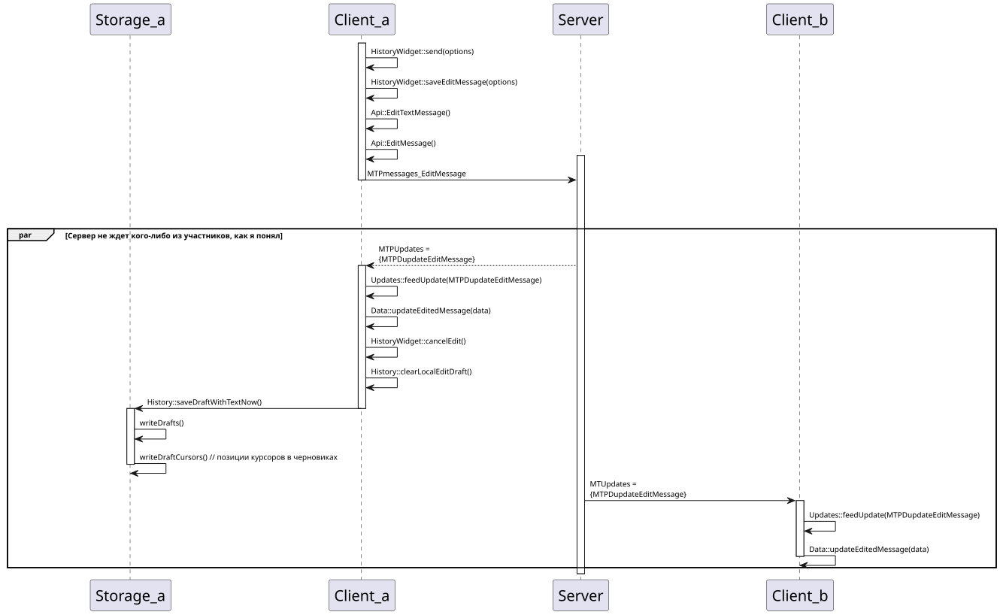
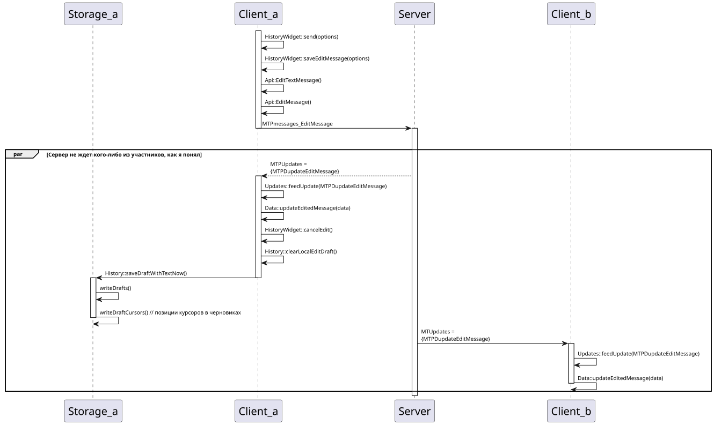
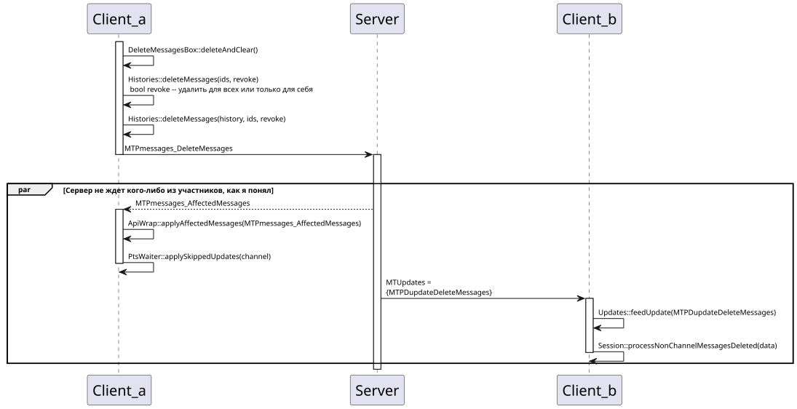

# 1. <span style="color:white">Система сообщений</span>
Структура сообщений описана в tdesktop/out/Telegram/gen/scheme.h и является сгенерированным кодом.

Все возможные id типов сообщений определены в огромном enum в самом начале scheme.h вперемешку с другими типами данных, которые сообщениями сами по себе не являются, но описывают типы данных внутри сообщений. Тип доступен через метод type().

## 1.1 Как отличить отличать сообщения клиент->сервер, сервер->клиент и просто дланные
1. Все посылаемые клиентом сообщения помечены как RPC method комментарием в коде, они так же имеют поле ResponseType != void.
2. Все принимаемые клиентом сообщения не помечены комментарием и имеют ResponseType = void. (Но они все равно могут быть лишь частью другого получаемого сообщения).
3. Все классы данных, что не могут являться сообщением, не имеют поля ResponseType, либо имеют ResponseType = void, но встречаются только внутри других классов, а сами не отправляются, нужно смотреть в коде.

Для обработки приходящего с сервера сообщения нужно скастовать его к конкретному типу данных, которое оно содержит, **ОБЯЗАТЕЛЬНО** сначала проверив, что тип совпадает, а затем вызвав предоставленный метод c_{имя типа}().

Например, вот как это выглядит с классом MTPMessage:

``` C++
void DoSmth(const MTPMessage& msg) {
    switch (msg.type()) {
        case mtpc_messageEmpty:
        const MTPDMessageEmpty& data = msg.c_messageEmpty();
        ...
        case mtpc_message:
        const MTPDMessage& data = msg.c_message();
        ...
        case mtpc_messageService:
        const MTPDMessageService& data = msg.c_messageService();
        ...
    }
    ...
}
```

Или можно использовать предоставленный match, но тогда нужно обработать каждый конструктор, т.е. нельзя, например, разобрать только случай MTPDmessage, а на остальные забить:

``` C++
int DoSmth(const MTPMessage& msg) {
	return msg.match([](const MTPDmessageEmpty& data) {
		return 0;
	}, [](const MTPDmessage& data) {
		return 1;
	}, [](const MTPDmessageService& data) {
		return 2;
	});
}
```

Вообще об этом и о прочем так же рассказано в api_usage.mdc

Стоит заметить, что 
``` C++
using MTPMessage = tl::boxed<MTPmessage>;
```
причём
``` C++
template <typename bare>
class boxed : public bare {
	using bare::bare;
    ...
}
```
Вот такая специфика наследования, видимо для разделения разных логик.

## 1.2  <span style="color:white">Сообщения клиент->сервер, которые может быть есть смысл шифровать/обрабатывать для скрытия информации, пользовательские сообщения помечены "пользовательское", но могут быть неточности </span>

### <span style="color:green"> Точно должны быть зашифрованы </span>

**MTPmessages_SendMessage** пользовательское

**MTPmessages_SendMedia** пользовательское

**MTPmessages_SendInlineBotResult** пользовательское (например @pic, отсылка полученных от бота результатов в чат, нужно шифровать)

**MTPmessages_SendMultiMedia** пользовательское

**MTPmessages_EditMessage** пользовательское

**MTPmessages_CreateChat** пользовательское

**MTPmessages_SaveDraft** пользовательское? (думаю, это можно считать пользовательским, хотя и происходит это автоматически, очевидно, это надо шифровать)

**MTPmessages_Search** пользовательское

**MTPmessages_SearchGlobal** пользовательское

**MTPmessages_GetSearchCounters** пользовательское

**MTPmessages_GetSearchResultsCalendar** пользовательское

**MTPmessages_GetSearchResultsPositions** пользовательское

**MTPmessages_SearchSentMedia** пользовательское

**MTPmessages_EditChatTitle** пользовательское

**MTPmessages_EditChatAbout** пользовательское

**MTPmessages_EditForumTopic** пользовательское

**MTPmessages_CreateForumTopic** пользовательское

**MTPmessages_ExportChatInvite** пользовательское? (имеет title)

**MTPmessages_EditExportedChatInvite** пользовательское (title)

**MTPmessages_CheckQuickReplyShortcut** пользовательское? (проверка существования шорткат сообщения)

**MTPmessages_EditQuickReplyShortcut** пользовательское

**MTPmessages_UploadMedia** пользовательское (передаётся имя загруженного файла)

### <span style="color:green">Точно нужно шифровать, отправка файлов </span>

Отправка и приём файлов не синхронизированы, поэтому нельзя просто шифровать эти реквесты, скорее всего, файлы придётся шифровать/дешифровать целиком, тут сложно в общем.

**MTPupload_SaveFilePart** пользовательское (отправляет очередной кусок файла)

**MTPupload_saveBigFilePart** пользовательское (аналогично)

### <span style="color:yellow"> Второстепенное, возможно стоит шифровать </span>

**MTPchannels_CheckSearchPostsFlood** пользовательское (если предполагается поддержка каналов)

**MTPchannels_SearchPosts** пользовательское (аналогично)

**MTPchannels_CreateChannel** пользовательское (аналогично)

**MTPchannels_EditTitle** пользовательское (аналогично)

**MTPmessages_SearchStickerSets** пользовательское (вряд ли нам нужны зашифрованные названия стикерпаков)

**MTPstories_SearchPosts** пользовательское (desktop клиент не может создавать сторис, так что вряд ли понадобится этот тип, но все же)

**MTPmessages_SearchEmojiStickerSets** пользовательское (аналогично)

**MTPcontacts_Search** пользовательское (если будем шифровать контакты)

**MTPcontacts_AddContact** пользовательское (аналогично)

**MTPcontacts_UpdateContactNote** пользовательское (аналогично)

**MTPmessages_ForwardMessages** пользовательское (имеет поле MTPInputQuickReplyShortcut, в котором есть текст)

**MTPphone_CreateGroupCall** пользовательское (title)

**MTPphone_EditGroupCallTitle** пользовательское

**MTPaccount_UpdateProfile** пользовательское (имя, фамили, о себе)

**MTPhelp_EditUserInfo** пользовательское (это видит поддержка телеграм)

**MTPchatlists_ExportChatlistInvite** пользовательское

**MTPchatlists_EditExportedInvite** пользовательское

**MTPmessages_UpdateDialogFilter** пользовательсоке (потенциально содержит названия фильтров)

**MTPmessages_UpdateSavedReactionTag** пользовательское? (имеет title)

**MTPmessages_EditFactCheck** пользовательское (я никогда такого функционала в телеграм даже не видел)

### <span style="color:orange"> Возможно стоит обрабатывать как-то ещё </span>

**MTPmessages_GetSponsoredMessages** (реклама, можно убрать)

**MTPmessages_translateText** пользовательское? (имеет смысл отбрасывать)

**MTPmessages_DeleteMessages** пользовательское (имеет смысл шифровать, если мы хотим скрыть сам факт удаления сообщения, но тут много моментов, как именно это делать и как отреагирует сервер)

**MTPchannels_DeleteMessages** пользовательское (аналогично)

**MTPmessages_DeleteHistory** пользовательское (аналогично с DeleteMessage)

**MTPmessages_deletePhoneCallHistory** пользовательское (аналогично)

**MTPmessages_SendVote** пользовательское (аналогично)

**MTPmessages_deleteScheduledMessages** пользовательское (аналогично, но тут еще сложней)

**MTPmessages_SetTyping** (шифровать тут нечего, но можно такие сообщения вообще отбрасывать, чтобы скрыть факт набора текста)

**MTPmessages_SendScreenshotNotification** пользовательское? (аналогично)

**MTPmessages_ReadHistory** (аналогично)

**MTPchannels_ReadHistory** (аналогично)

**MTPmessages_ReadMessageContents** (аналогично)

**MTPmessages_ReadMentions** (аналогично)

**MTPmessages_markDialogUnread** (аналогично)

**MTPmessages_ReadDiscussion** (аналогично)

**MTPmessages_ReadReactions** (аналогично)

**MTPmessages_readSavedHistory** (аналогично)

**MTPaccount_UpdateStatus** (аналогично. Статус онлайн)

**MTPstories_ReadStories** (аналогично)


### <span style="color:darkred"> Не уверен, что с этим делать </span>

**MTPmessages_initHistoryImport** (импорт чатов)

**MTPmessages_UploadImportedMedia** (импорт чатов)

**MTPmessages_GetWebPagePreview** (превью странички по ссылке в сообщении, возможно, это стоит отбрасывать целиком, шифрование сломает логику на сервере)

**MTPmessages_RequestWebView**, **MTPmessages_ProlongWebView**, **MTPmessages_RequestSimpleWebView**, **MTPmessages_SendWebViewData**, **MTPmessages_RequestAppWebView**, **MTPmessages_RequestMainWebView** (не уверен, что делать с этим)

**MTPinitConnection** (сообщает серверу много информации о пользователе _device_model, _system_version, _app_version, _api_id, _lang_pack, _lang_code, _proxy)

**MTPmessages_StartBot** пользовательское? (имеет поле _start_param)

**MTPmessages_GetEmojiKeywords**, **MTPmessages_GetEmojiKeywordsDifference**, **MTPmessages_GetEmojiURL** (потенциально соощают серверу используемый язык, поле _lang_code/_lang_codes)

### <span style="color:darkred"> Не используется в desktop </span>

**MTPmessages_SetInlineBotResults** (не пользовательское, используется ботом, имеет смысл, если бот шифрует сообщения)

**MTPmessages_GetInlineBotResults** пользовательское? (например @pic, по идее, здесь мы от бота получим результат, но получатель бот, так что вряд ли это нужно)

**MTPstories_SendStory**, **MTPstories_EditStory** (desktop не посылает истории)

**<span style="color:white"> Все остальные клиент->сервер сообщения либо точно служебные без сразу очевидной причины что-то с ними делать, либо так же не используются в десктопе. </span>**

## <span style="color:white"> Детали шифрования клиент->сервер </span>

**TODO**

##  <span style="color:white"> 1.3 Сообщения сервер->клиент, которые может быть есть смысл дефровать/обрабатывать для скрытия информации. </span>

Вообще, приходить не в ответ на какой-либо запрос клиенту могут только MTPnewSession и MTPUpdates, так что искать остальные типы, нужно среди ResponseTypes, все остальное не будет отправляться, максимум будет составной частью сообщений, поэтому упустить дешифрование этих частей будет сложно.

### <span style="color:green"> Должны быть расшифрованы от важных к менее важным </span>

**MTPmessages_Messages**

**MTPUpdates**

**MTPupdates_Difference**

**MTPmessages_ForumTopics**

**MTPmessages_Dialogs**

**MTPmessages_ChatFull**

**MTPmessages_Chats**

**MTPmessages_PeerDialogs**

**MTPmessages_SavedDialogs**

**MTPmessages_QuickReplies**

**MTPupload_File** (это произвольный отрезок файла, для корректного дешифрования файлов нужно что-то большее, чем просто перехват сообщений)

**MTPupload_CdnFile** (аналогично)

**MTPupload_WebFile** (аналогично)

**MTPmessages_InvitedUsers**, **MTPpayments_paymentResult** (внутри есть либо message, либо updates, но это не факт, что там есть что расшифроварывать)

**MTPDocument** (имя файла)

**MTPVector<MTPDocument>** (аналогично)

**MTPVector<MTPWallPaper>** (аналогично)

**MTPWallPaper** (аналогично)

**MTPExportedChatInvite**

**MTPmessages_ExportedChatInvite**

**MTPmessages_ExportedChatInvites**

**MTPmessages_SearchResultsCalendar**

**MTPmessages_SearchResultsPositions**

**MTPmessages_InactiveChats** (есть чаты)

**MTPmessages_MessageReactionsList** (есть чаты)

**MTPmessages_MessageViews** (есть чаты)

**MTPmessages_PeerSettings** (есть чаты)

**MTPmessages_VotesList** (есть чаты)

**MTPmessages_WebPage** (есть чаты и пр.)

**MTPmessages_WebPagePreview** (есть чаты и медиа)

**MTPphone_GroupCall** (есть чаты)

**MTPmessages_DiscussionMessage** (это относится к чатам, прикрепленным к каналам, по идее, нам это не нужно)

**MTPphone_GroupParticipants** (есть чаты)

**MTPphone_JoinAsPeers** (есть чаты)

**MTPusers_UserFull** (есть чаты)

**MTPusers_Users** (есть чаты)

**MTPmessages_SponsoredMessages** (реклама, можно убрать в теории)

# 2. Шифрование

## 2.1 Касательно точек интеграции шифрования и дешифрования 
Учитывая большое количество типов сообщений, что нужно шифровать, лучшче подойдёт вставка шифрования в метод request у классов MTP::Sender и MTP::ConcurrentSender. Таким образом, можно обрабатывать вообще все RPC к серверу с минимальной инвазивностью, но могут возникнуть другие проблемы, например: шифрование изменяет (увеличивает) размер текста, если после шифрования длина сообщения становится больше константы, определённой в коде, сервер отбросит это сообщение...

Для дешифрования же сообщений, должна подойти точка Session::tryToReceive(), а вот какие именно изменения нужно сделать:

``` C++
if (message.requestId) {
    instance->processCallback(Decrypt(message)); // RPC ответы
} else if (main) {
    // Process updates only in main session.
    instance->processUpdate(Decrypt(message)); // Всё остальное
}
``` 

Однако, последствием будет то, что локальное хранилище будет получать незашифрованные данные, поэтому если мы хотим хранить их зашифрованными, а ключи держать под паролем, то придётся добавлять шифрование заново куда-то в функционал хранилища.

Эти точки значительно удобнее почти во всём, чем те, что я раньше хотел выбрать.

## 2.2 Детали шифрования

### 2.2.1 Текстовые сообщения

Сообщения содержат поле MTPVector<MTPMessageEntity> _entities, которое хранит информацию о форматировании в тексте, там находится информация, например, о том, какие отрезки в тексте выделены жирным или курсивом, может хранить целые ссылки и тоже и их позиции в тексте. Легче всего на этапе шифрования просто отбрасывать такие детали, иначе нужно придумывать, как это шифровать.
Так же в поле MTPInputReplyTo _reply_to может быть текст пересылаемого сообщения, а в MTPInputQuickReplyShortcut _quick_reply_shortcut есть шорткат строка, либо id такой строки.

### 2.2.2 Хранилище

Десктопный телеграм не имеет полноценного локального хранилища для всей истории. Кешируется различная информация: ключи, пасскоды, файлы, медиа, обои чатов, иконки чатов и аватарки людей, описания чатов и профилей людей (about), названия чатов, настройки, черновики, хештеги(?) и подобное. История чатов не сохраняется, кешируется только медиа и файлы, но не текст. Самое важное из этого можно посмореть в storage_account.h. Из всего этого шифровать имеет смысл, наверное, только файлы, медиа, черновики, описания и иконки чатов, может ещё хештеги. В общем довольно большая работа, ради меньшей части предполагаемо тайной информации. В конце концов, рабочую директорию телеграма можно разместить на зашифрованном диске и там же хранить ключ для шифрования сообщений, поэтому, мне кажется, что шифрование локального хранилища в этом проекте $-$ лишняя работа.

### 2.2.3 Изменение Api

В последней версии на github немного изменилась структура сообщений: добавилось строковое поле summary_from_language в сообщениях, тоже надо будет его обрабатывать. 

# 3. UML диаграммы взаимодействия компонентов

## 3.1 saved messages, стабильный интернет, только текст.



## 3.2 клиент а -> клиент б, стабильный интернет, только текст.


## 3.3 клиент а -> группа с клиентом б, стабильный интернет, только текст.



## 3.4 saved messages, стабильный интернет, редактирование текстового сообщения.



## 3.5 клиент а -> клиент б, стабильный интернет, редактирование текстового сообщения.



## 3.6 клиент а -> группа с клиентом б, стабильный интернет, редактирование текстового сообщения.



## 3.7 клиент а -> клиент б, стабильный интернет, удаление текстового сообщения для всех.

Сервер не ждет никакого подтверждения от клиента б.



## 3.8 клиент а -> клиент б, стабильный интернет, отсылка txt файла.


Файлы разумнее всего будет шифровать целиком до отправки.